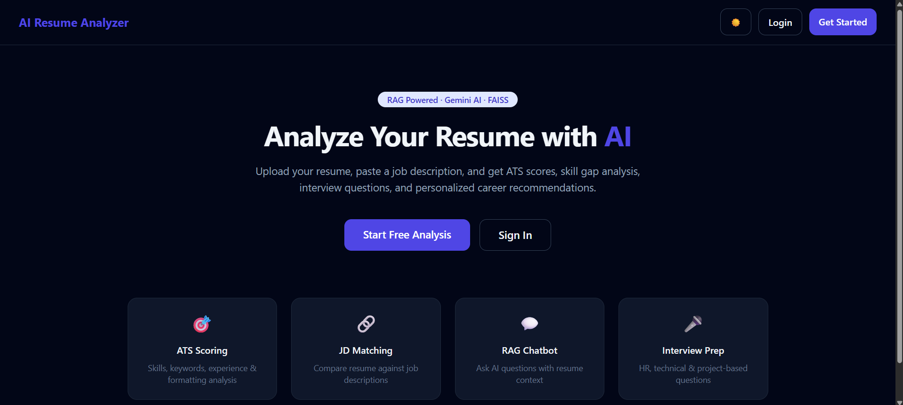
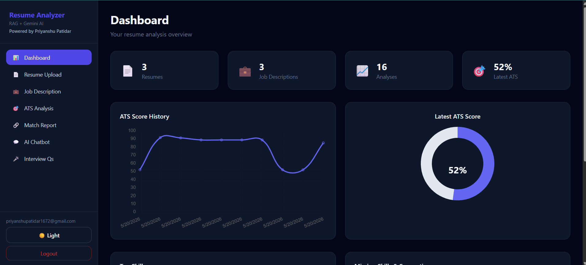
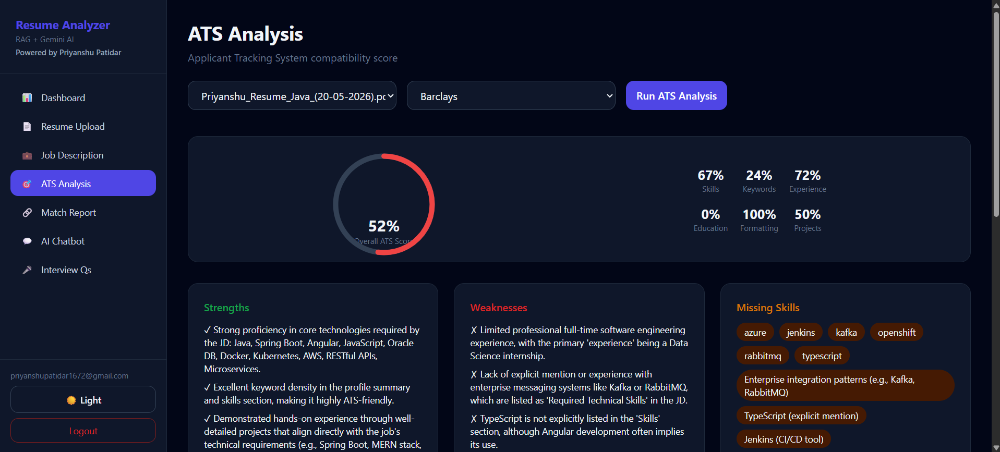

# AI Resume Analyzer – RAG Powered

A production-ready full-stack AI Resume Analyzer that uses **FastAPI**, **React**, **LangChain**, **FAISS**, and **Google Gemini** to deliver ATS scoring, resume–JD matching, skill gap analysis, RAG chat, and interview question generation.


## Features

- **JWT Authentication** – Register, login, protected routes
- **Resume Upload** – PDF parsing with PyMuPDF + NLP/Gemini enrichment
- **Job Description** – Paste text or upload JD PDF
- **ATS Score Engine** – Skills, keywords, experience, education, formatting, projects
- **Resume vs JD Matching** – Match %, missing tech, improvements
- **RAG AI Chatbot** – FAISS retrieval + Gemini with conversation memory
- **Interview Questions** – HR, technical, resume & project-based
- **Dashboard** – Charts, skills, suggestions, ATS history
- **Dark Mode** – Responsive Tailwind UI

## Architecture

```
Resume PDF → PyMuPDF → Chunking → Sentence Transformers → FAISS
    → RAG Retrieval → Gemini → ATS / Chat / Suggestions
```

See [docs/architecture.md](docs/architecture.md) for the full diagram.

## Tech Stack

| Layer | Technologies |
|-------|-------------|
| Backend | Python, FastAPI, LangChain, FAISS, Gemini, PyMuPDF, spaCy, Sentence Transformers |
| Frontend | React, Tailwind CSS, Axios, React Router, Chart.js |
| DevOps | Docker, GitHub Actions, Vercel, Render/Railway |

## Quick Start

### Prerequisites

- Python 3.11+
- Node.js 20+
- [Gemini API key](https://aistudio.google.com/app/apikey)

### 1. Clone & configure

```bash
git clone <your-repo-url>
cd AI-Resume-Analyzer-RAG

cp backend/.env.example backend/.env
# Edit backend/.env and set GEMINI_API_KEY and SECRET_KEY
```

### 2. Backend

```bash
cd backend
python -m venv venv
# Windows: venv\Scripts\activate
# macOS/Linux: source venv/bin/activate
pip install -r requirements.txt
uvicorn app.main:app --reload --host 0.0.0.0 --port 8000
```

API docs: http://localhost:8000/docs

### 3. Frontend

```bash
cd frontend
cp .env.example .env
npm install
npm run dev
```

App: http://localhost:5173

### Docker

```bash
docker compose up --build
```

## API Endpoints

| Method | Endpoint | Description |
|--------|----------|-------------|
| POST | `/api/auth/register` | Register user |
| POST | `/api/auth/login` | Login (OAuth2 form) |
| POST | `/api/resume/upload` | Upload resume PDF |
| POST | `/api/jd/upload` | Upload JD (text or PDF) |
| POST | `/api/analyze/ats-score` | ATS analysis |
| POST | `/api/analyze/match` | Resume–JD match |
| POST | `/api/chat/query` | RAG chat |
| POST | `/api/generate/interview-questions` | Interview Qs |
| GET | `/api/dashboard/stats` | Dashboard stats |

## Environment Variables

**Backend (`backend/.env`):**

```env
GEMINI_API_KEY=your_api_key
SECRET_KEY=your-secret-key
GEMINI_MODEL=gemini-1.5-flash
DATABASE_URL=sqlite+aiosqlite:///./resume_analyzer.db
CORS_ORIGINS=http://localhost:5173
```

**Frontend (`frontend/.env`):**

```env
VITE_API_URL=http://localhost:8000/api
```

## Deployment

### Frontend (Vercel)

1. Import `frontend/` as the root directory.
2. Set `VITE_API_URL` to your deployed backend URL + `/api`.
3. Build command: `npm run build`, output: `dist`.

### Backend (Render / Railway)

1. Deploy `backend/` with start command:
   `uvicorn app.main:app --host 0.0.0.0 --port $PORT`
2. Add env vars from `.env.example`.
3. Mount persistent disk for `uploads/` and `vectorstore/` if needed.

## Screenshots

| Home | Dashboard | ATS Analysis |
|------|-----------|--------------|
|  |  |  |

_Add screenshots to `docs/screenshots/` and they will appear here._

## Project Structure

```
AI-Resume-Analyzer-RAG/
├── backend/
│   ├── app/
│   │   ├── api/
│   │   ├── services/
│   │   ├── rag/
│   │   └── models/
│   ├── uploads/
│   └── vectorstore/
├── frontend/
├── docs/
├── .github/workflows/
└── README.md
```

## License

MIT – use freely for learning and portfolio projects.
